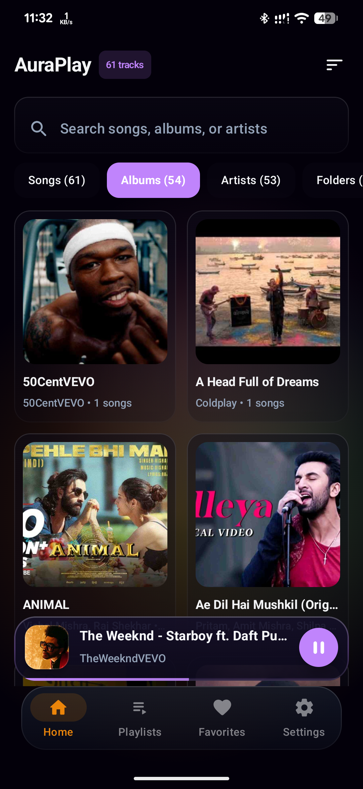
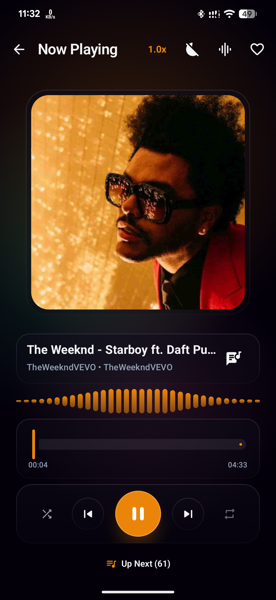
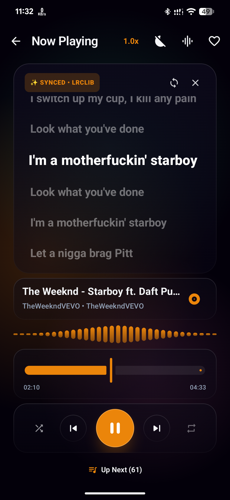

# 🎵 AuraPlay Music Player

<div align="center">


[](https://kotlinlang.org)
[](https://developer.android.com/jetpack/compose)
[](https://developer.android.com/guide/topics/media/media3)
[](https://developer.android.com/training/data-storage/room)
[](https://github.com/Shahriar811/AuraPlay/releases/latest)
[](LICENSE)

<p align="center">
  <b>A modern, fluid, and aesthetic local music player for Android built entirely with Kotlin and Jetpack Compose.</b><br/>
  <br/>
  <a href="https://github.com/Shahriar811/AuraPlay/releases/latest">
    
  </a>
</p>

</div>

---

## 📥 Download & Installation

1. Go to the [**Latest Releases**](https://github.com/Shahriar811/AuraPlay/releases/latest) page.
2. Download `app-debug.apk` (or `AuraPlay.apk`).
3. Open the downloaded file on your Android device and tap **Install** (allow *Install from Unknown Sources* if prompted).


---

## 📱 Screenshots

The screenshots below show the earlier theme. The current UI follows a charcoal and soft-green design with a home feed, shared mini-player, and artwork-led playback screen. See [the update and validation notes](docs/theme-and-performance.md) and [the new feature guide](docs/features-1.1.md).

Version 1.1.2 adds library multi-select playback and visible Equalizer, Bookmarks, and Sleep timer shortcuts, fixes queue theme highlighting, and removes additional launch/scrolling work. See [the launch and player changes](docs/launch-and-player-1.1.2.md) for behavior and validation limits.

<div align="center">
  <table>
    <tr>
      <td align="center" width="33%">
        <b>🏠 Home & Library</b><br/><br/>
        
      </td>
      <td align="center" width="33%">
        <b>🎧 Now Playing & Waveform</b><br/><br/>
        
      </td>
      <td align="center" width="33%">
        <b>🎤 Synced Live Lyrics</b><br/><br/>
        
      </td>
    </tr>
  </table>
</div>

---

## ✨ Features

### 🎨 Modern & Dynamic UI
* **Soft Green Theme:** Charcoal surfaces, pale green accents, rounded cards, and optional colors extracted from album artwork.
* **Artwork-led Player:** Full-width artwork, pill controls, lyrics, and a shared mini-player across the main screens.
* **Pure Black (AMOLED) Mode:** Battery-saving true black background option tailored for OLED displays.
* **Custom Accent Colors:** Switch between *Dynamic Aura*, *Electric Purple*, *Cyan Blue*, *Sunset Orange*, *Emerald Green*, and *Warm Gold*.
* **Efficient Library Rendering:** Shared library data, background grouping, bounded artwork requests, and isolated playback progress updates.

### 🎤 Synchronized Real-Time Lyrics
* **LRCLIB Integration:** Automatically fetches synchronized time-stamped lyrics online with line-by-line auto-scrolling.
* **Interactive Lyrics View:** Tap any lyric line to jump directly to that timestamp in the track.
* **Offline Caching:** Cached lyrics for quick offline viewing.

### 🎚️ Audio Enhancement & Playback
* **Built-in Multi-Band Equalizer:** Fine-tune audio frequencies with custom sliders, Bass Boost, and Virtualizer.
* **Audio Presets:** Quick presets including *Normal, Pop, Rock, Jazz, Classical, Hip Hop, Dance, Heavy Metal, Folk, and Flat*.
* **Optional Waveform Animation:** A lightweight playback animation with an interactive seekbar.
* **Playback Speed:** Variable pitch-preserving speed control (0.5x to 2.0x).
* **Sleep Timer:** Set a countdown timer with smooth volume fade-out or choose **End of Track** to automatically pause when the current song completes.

* **Resume after restart:** Restore the song, position, repeat mode and queue, including shuffle order. Playback stays paused until requested.
* **Crossfade:** Optional two-decoder overlap from 1 to 12 seconds; end-of-track sleep timers take priority.
* **ReplayGain:** Off, Track, or Album gain from embedded ReplayGain tags, with peak protection. Untagged tracks retain their original volume.
* **Saved EQ:** Equalizer settings survive service restarts and follow the active crossfade session.

### 🗂️ Smart Library & Organization
* **Categorized Navigation:** Browse by **Songs**, **Albums**, **Artists**, and device **Folders**.
* **Instant Search & Multi-Sort:** Fast search by title, artist, or album; sort by title, artist, or date added.
* **Playlists & Favorites:** Create and manage custom playlists and favorite tracks with one tap.
* **Dynamic Queue Manager:** Play next, add to queue, drag to reorder, and remove songs. The queue follows the actual shuffle order and supports duplicate songs.

* **Smart Playlists:** Recently added, unplayed discoveries, forgotten favorites, and this week's favorites.
* **Music Folders:** Include selected folders and subfolders, or hide folders throughout library views.
* **Song Information:** Edit title, artist, album, and cover within AuraPlay. Edits survive rescans and leave source audio files unchanged.
* **Audio Bookmarks:** Name timestamps in the player and find or play them from Playlists → Audio bookmarks.
* **Listening Statistics:** Actual playback time, daily bars, weekly artist rankings, monthly summaries, and play counts.
* **Portable Backup:** Export or merge playlists, likes, bookmarks, edits/covers, listening history, play counts, and settings with a ZIP file. Audio files are referenced rather than copied.

### ⚡ Background Service & Widgets
* **Media3 Foreground Service:** Seamless background playback powered by `MediaSessionService` and ExoPlayer.
* **System Media Controls:** Full support for Android 11+ notification shade and lockscreen media player with interactive seekbar and tap-to-open session activity.
* **Home Screen Widgets:** Compact, Large, and Artwork styles with cover images, resize support, configuration, and playback controls that reconnect after a restart.
* **Headphone Unplug Detection:** Automatically pauses audio when headphones are disconnected (`ACTION_AUDIO_BECOMING_NOISY`).

---

## 🛠 Tech Stack

* **Language:** 100% [Kotlin](https://kotlinlang.org/)
* **UI Framework:** [Jetpack Compose](https://developer.android.com/jetpack/compose) with Material 3
* **Audio Engine:** [AndroidX Media3 (ExoPlayer & MediaSession)](https://developer.android.com/guide/topics/media/media3)
* **Architecture:** MVVM (Model-View-ViewModel) with StateFlow
* **Database:** [Room Database](https://developer.android.com/jetpack/androidx/room) with SQLite
* **Networking:** Android HttpURLConnection (for LRCLIB lyrics fetching)
* **Image Loading:** [Coil](https://coil-kt.github.io/coil/)
* **Color Extraction:** [AndroidX Palette](https://developer.android.com/develop/ui/views/graphics/palette-colors)
* **Preferences:** [Jetpack DataStore](https://developer.android.com/topic/libraries/datastore) (Preferences)
* **Navigation:** [Jetpack Navigation Compose](https://developer.android.com/jetpack/compose/navigation)

---

## 📂 Project Structure

```
com.example.auraplay/
├── data/
│   ├── Song.kt                  # Song data model & metadata
│   ├── Playlist.kt              # Playlist entity & cross-references
│   └── AppDatabase.kt           # Room DB instance & DAO definitions
├── service/
│   └── MusicService.kt          # Media3 MediaSessionService & player state
├── ui/
│   ├── HomeScreen.kt            # Main library tabs (Songs, Albums, Artists, Folders)
│   ├── PlayerScreen.kt          # Full-screen Now Playing, Waveform, & Lyrics
│   ├── EqualizerScreen.kt       # Multi-band Equalizer & audio presets
│   ├── PlaylistScreen.kt        # Playlists & favorites view
│   ├── SettingsScreen.kt        # Theme, accents, pure black, and sleep timer
│   ├── ColorExtractor.kt        # Palette dynamic color processing
│   └── Glassmorphism.kt         # Custom frosted-glass modifiers
├── widget/
│   └── AuraPlayAppWidgetProvider.kt # Homescreen interactive widget
├── LyricsManager.kt             # LRCLIB API client & synced parser
├── EqualizerManager.kt          # Android audio effect session controller
├── MainViewModel.kt             # Central app state management
└── MainActivity.kt              # Main entry point & permission flow
```

---

## 🚀 How to Build & Run

### Prerequisites
* **Android Studio** Hedgehog (2023.1.1) or newer
* **JDK:** 17 or higher
* **Android SDK:** Compile/target SDK 36, minimum SDK 26 (Android 8.0+)

### Steps
1. **Clone the repository:**
   ```bash
   git clone https://github.com/Shahriar811/AuraPlay.git
   cd AuraPlay
   ```
2. **Open the project** in Android Studio.
3. **Sync Project with Gradle Files**.
4. **Build & Run** on a physical device or emulator:
   ```bash
   ./gradlew assembleDebug
   ```

For an installable build with release optimizations, use `./gradlew assemblePerformance`. Run `./gradlew testDebugUnitTest lintDebug` for regression tests and static checks. The optimized APK is generated at `app/build/outputs/apk/performance/app-performance.apk`.

---

## 📄 License

This project is licensed under the MIT License - see the [LICENSE](LICENSE) file for details.
